# README.md
```markdown
# Work 1: Secure REST API Development with CI/CD and Real CVE Vulnerability Analysis
## Project Overview
This project implements a secure REST backend API based on Python Flask. It includes user registration‑login authentication with JWT token, protected resource access, database persistence using SQLite + SQLAlchemy ORM. GitHub Actions CI/CD pipeline integrates SAST and SCA automated security scanning. Besides, the lab reproduces and mitigates the Apache Solr CVE‑2019‑17558 vulnerability using Vulhub docker environment.

### Implemented API Endpoints
1. `POST /auth/login`
    - Function: User login, verify username‑password hash, return JWT access‑token on successful authentication.
    - Request body example: `{"username":"test","password":"xxx"}`
2. `GET /api/data`
    - Function: Query and return user list data. **Protected endpoint, requires valid Bearer JWT token in HTTP Authorization header.**
    - Without valid token, server returns `401 UNAUTHORIZED`.
3. `POST /api/post`
    - Custom defined endpoint: create new post resource, also protected by JWT middleware.
    - Require valid JWT token from request header.

> Storage: SQLite file‑based database, operated by SQLAlchemy ORM.

## Implemented Basic Security Measures
### 1. Protection against SQL Injection
The application uses **SQLAlchemy ORM** for all database operations. All user‑supplied inputs are processed by ORM parameter‑binding mechanism. **No manual string concatenation is used to construct SQL statements**, which eliminates SQL‑injection attack surfaces.

### 2. Protection against XSS (Cross‑Site Scripting)
API responses use Flask built‑in `jsonify()` function to serialize and return JSON data. This built‑in method automatically escapes special meta‑characters inside user‑provided content. Malicious HTML / JavaScript payload cannot take effect in JSON API responses.

### 3. Mitigation for Broken Authentication
1. **Password hash storage**: User passwords are hashed with `bcrypt` before saving into SQLite database. Plain‑text passwords are never persisted in database.
2. **Issue JWT after login**: After successful username‑password verification at `/auth/login`, server issues JWT access‑token for client usage.
3. **JWT verification middleware**: Custom middleware intercepts all protected endpoints (`/api/data`, `/api/post`). Incoming requests without valid Bearer JWT token get `401 Unauthorized` rejection.

## CI / CD Pipeline (GitHub Actions)
Every `push` and `pull_request` event triggers automatic workflow.
Pipeline jobs include:
1. Install Python project dependencies
2. Run `pytest` unit‑tests
3. **SAST — Bandit static source‑code scan**
    - Scan production source code, exclude unit‑test file `test_app.py`.
    - Scan result: `No issues identified` (0 Low / Medium / High vulnerabilities).
4. **SCA — OWASP Dependency‑Check software composition analysis**
    - Scan third‑party Python dependencies for known public CVEs, generate standalone HTML vulnerability report, uploaded as workflow artifact.
    - Detected one high‑severity entry in `Flask‑JWT‑Extended==4.4.2`. This CVE‑2025‑45770 exploit condition requires short weak JWT secret. Our project uses long high‑entropy secret loaded from environment variable, so this vulnerability cannot be triggered in our lab application. Upgrading this package will cause dependency resolution conflicts, risk breaking existing application functions, risk‑mitigation achieved via secure configuration.

> Last successful pipeline run link:
> https://github.com/YinJiayi23320105/work1/actions/runs/39541085544/job/119028735003

### Screenshots of security scanner reports

#### 1. CI Workflow overview
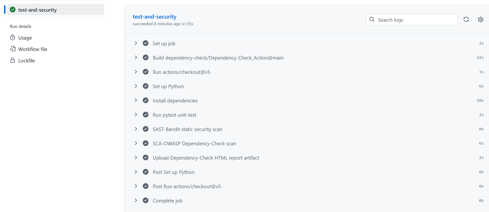

#### 2. SAST‑Bandit scan result (0 issues)
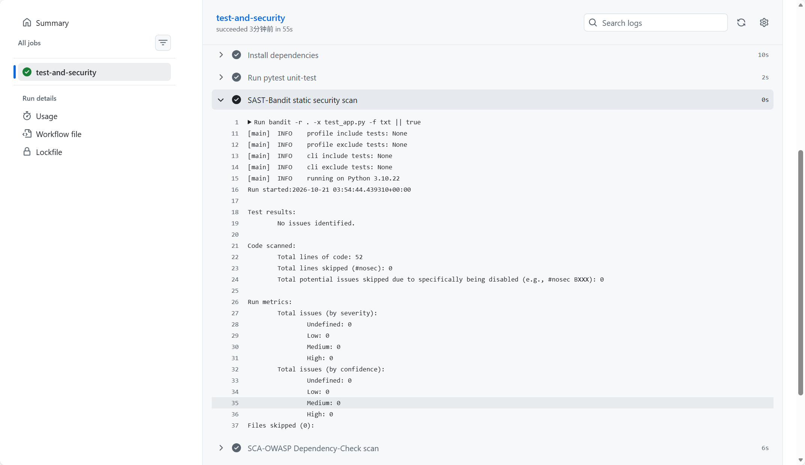

#### 3. SCA‑OWASP Dependency‑Check HTML report
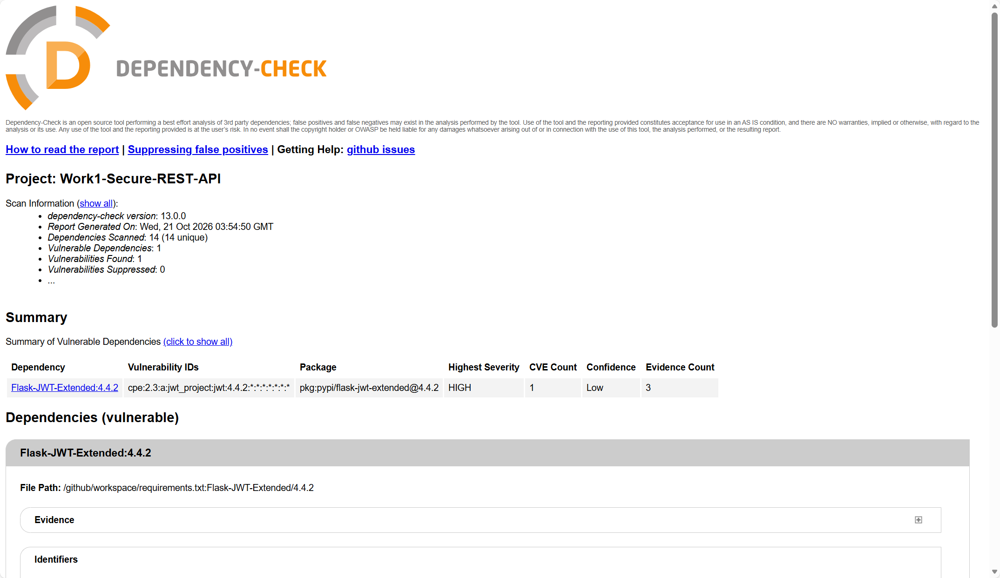

### API test screenshots
- Access protected endpoint without token (401 Unauthorized)
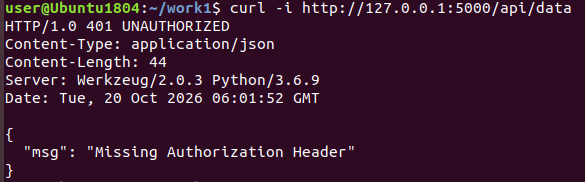

- User register success
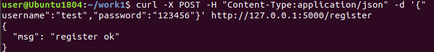

- Login and obtain JWT token
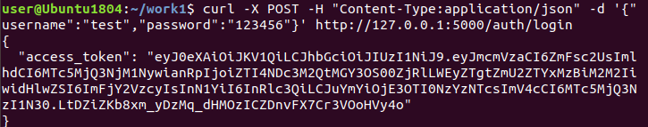

- Access protected GET /api/data with valid token
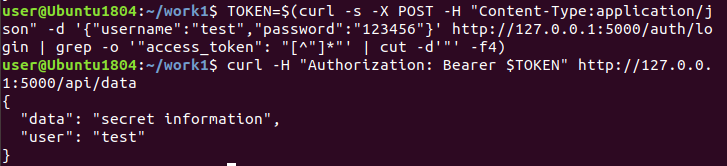

- POST create post resource with JWT
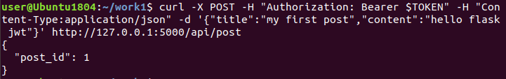

## Real‑World CVE Analysis: Apache Solr CVE‑2019‑17558
### Brief vulnerability description
Apache Solr Velocity Response Writer remote code execution vulnerability (CVE‑2019‑17558).
When `params.resource.loader.enabled` configuration is set to `true` for velocity query‑response‑writer, unauthenticated attackers can construct malicious velocity template payload to achieve remote code execution on Solr server.

### Reproduction sequence of actions
1. Start Apache Solr 8.3.1 vulnerable instance.
2. Create new solr core `testcore`.
3. Send `POST /solr/testcore/config` JSON request to enable dangerous velocity parameters:
```json
{
  "update-queryresponsewriter": {
    "startup": "lazy",
    "name": "velocity",
    "class": "solr.VelocityResponseWriter",
    "template.base.dir": "",
    "solr.resource.loader.enabled":true,
    "params.resource.loader.enabled":true
  }
}
```
4. Check config response: `params.resource.loader.enabled:true` takes effect, vulnerability condition activated.
5. Send malicious http request with velocity template payload to trigger RCE attack.

### Root‑cause analysis
The vulnerability originates from insecure configuration. When `params.resource.loader.enabled` is enabled, Solr allows HTTP request parameters to be parsed as Velocity template content. Malicious template syntax can invoke Java runtime classes to execute arbitrary system commands. The vulnerability is not caused by coding bugs, but unsafe default / manually‑modified switch configuration.

### Applied fix & remediation
Send POST request to set `params.resource.loader.enabled: false` to disable template parameter parsing feature:
```json
{
  "update-queryresponsewriter": {
    "startup": "lazy",
    "name": "velocity",
    "class": "solr.VelocityResponseWriter",
    "template.base.dir": "",
    "solr.resource.loader.enabled":true,
    "params.resource.loader.enabled":false
  }
}
```
After modification, the dangerous template‑injection entry point is closed.

### Proof of vulnerability elimination
1. Query solr core config page, confirm `params.resource.loader.enabled` value is `false`.
2. Repeat previous RCE exploit HTTP requests, attack payload no longer works, remote‑code‑execution cannot be achieved.
3. Regression‑test: Solr core basic search and query functions keep working normally, no service breakdown.

### Screenshots
1. Solr service startup log
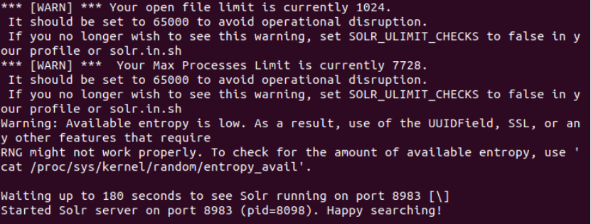

2. Create solr core
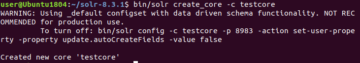

3. Curl request enable velocity RCE switch
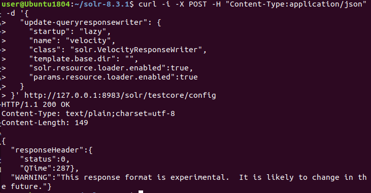

4. Verify dangerous config enabled in web UI
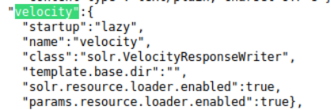

5. Exploit attempt result


6. Apply fix: disable params.resource.loader.enabled


7. Regression test after patching
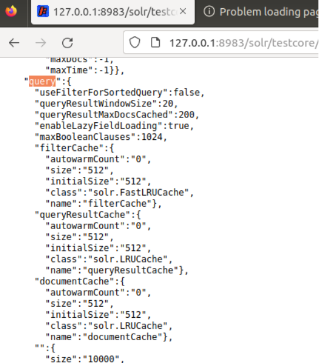

