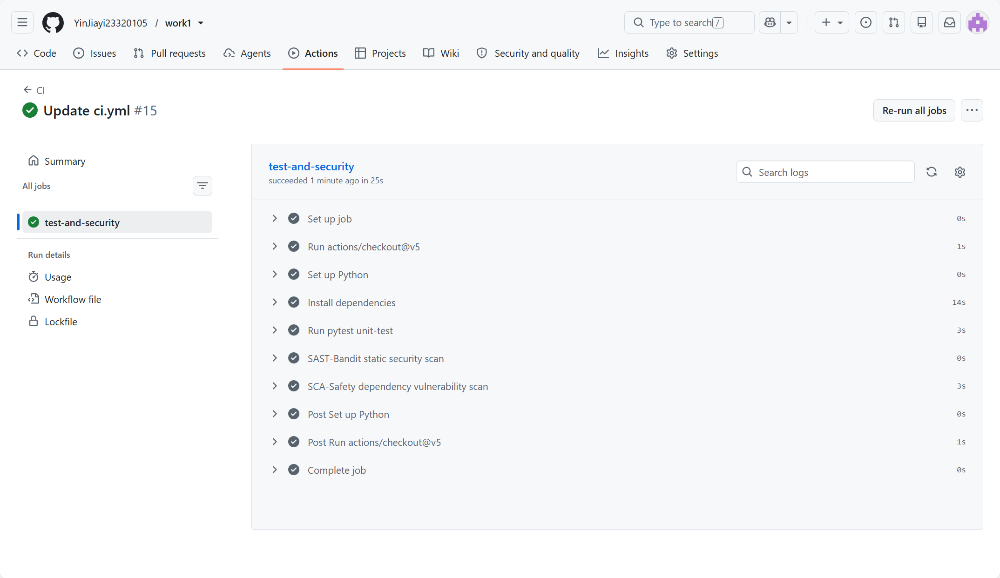
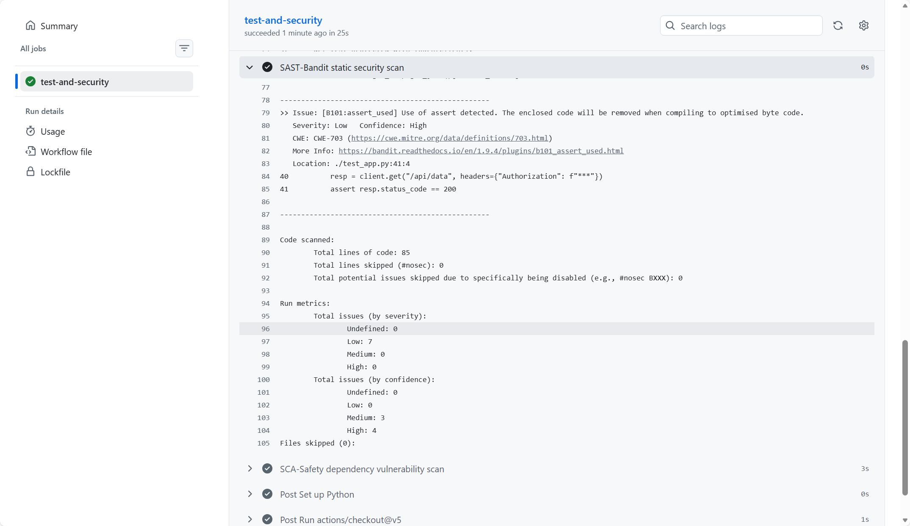
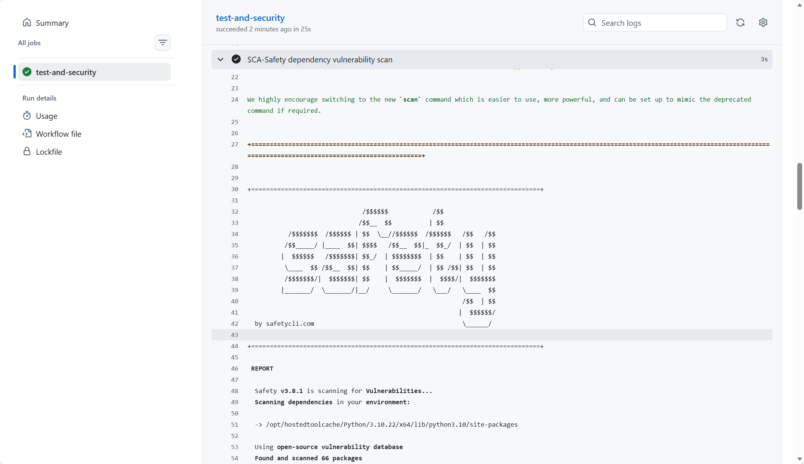
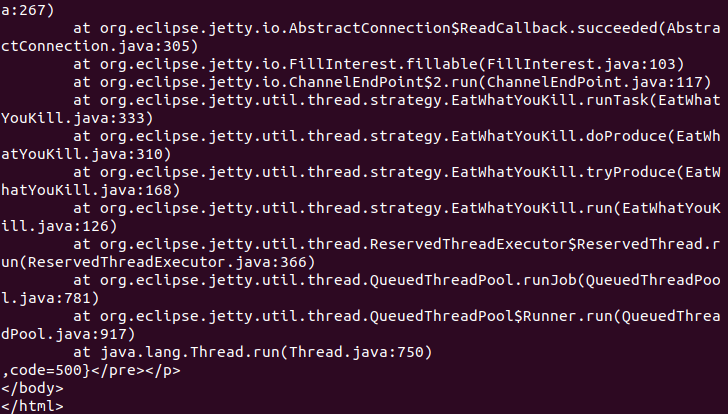
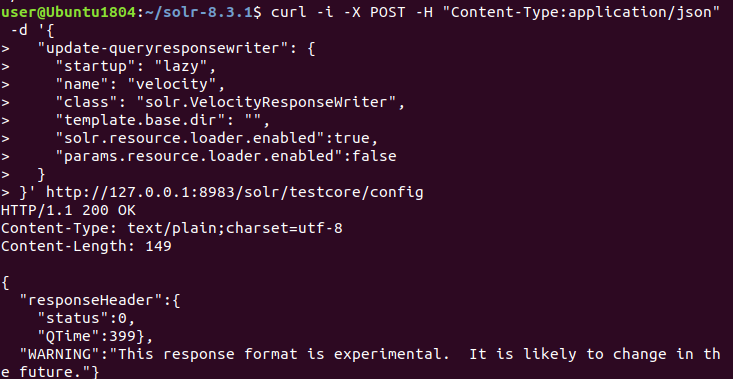

## 1. Project & API Description

**Tech Stack**: Python 3, Flask framework, SQLite lightweight database.

Four API endpoints are implemented in total. Three endpoints satisfy the mandatory lab requirements, and one is a custom‑defined protected endpoint.

- **`POST /auth/register`**
Register a new user account, store hashed user credentials.
Authorization: No authentication required.
- **`POST /auth/login`**
Verify username & password, return short‑lifetime JWT access‑token.
Authorization: No authentication required.
- **`GET /api/data`**
Return protected user/post dataset.
Authorization: **Bearer JWT token is mandatory**.
- **`POST /api/post`** (custom endpoint)
Custom protected endpoint, create new post entry.
Authorization: **Bearer JWT token is mandatory**.

### Example curl commands for API testing

```
# Register a new test user
curl -X POST -H "Content-Type:application/json" -d '{"username":"test","password":"123456"}' [http://127.0.0.1:5000/auth/register](http://127.0.0.1:5000/auth/register)

# Login and obtain JWT access‑token
curl -X POST -H "Content-Type:application/json" -d '{"username":"test","password":"123456"}' [http://127.0.0.1:5000/auth/login](http://127.0.0.1:5000/auth/login)

# Access protected resource WITHOUT token → expected 401 Unauthorized
curl -X GET [http://127.0.0.1:5000/api/data](http://127.0.0.1:5000/api/data)

# Access protected resource WITH valid JWT token
curl -X GET -H "Authorization: Bearer <REPLACE_WITH_YOUR_JWT_TOKEN>" [http://127.0.0.1:5000/api/data](http://127.0.0.1:5000/api/data)

# Call custom protected POST endpoint
curl -X POST -H "Content-Type:application/json" -H "Authorization: Bearer <REPLACE_WITH_YOUR_JWT_TOKEN>" -d '{"content":"hello work1"}' [http://127.0.0.1:5000/api/post](http://127.0.0.1:5000/api/post)
```

---


```
# Work 1: Secure REST API Development with CI/CD and Real CVE Vulnerability Analysis
Laboratory Work 1 for Cybersecurity course.

This project implements a secure Flask‑based REST API with authentication, protection against SQL injection and XSS. GitHub Actions CI/CD pipeline is integrated for automated SAST and SCA security scanning. Besides, this lab reproduces and remediates **CVE‑2019‑17558 Apache Solr Velocity Template Remote Code Execution Vulnerability**.

## 1. Project & API Description
**Tech Stack**: Python 3, Flask framework, SQLite lightweight database.

Four API endpoints are implemented in total. Three endpoints satisfy the mandatory lab requirements, and one is a custom‑defined protected endpoint.

- **`POST /auth/register`**
  Register a new user account, store hashed user credentials.
  Authorization: No authentication required.

- **`POST /auth/login`**
  Verify username & password, return short‑lifetime JWT access‑token.
  Authorization: No authentication required.

- **`GET /api/data`**
  Return protected user/post dataset.
  Authorization: **Bearer JWT token is mandatory**.

- **`POST /api/post`** (custom endpoint)
  Custom protected endpoint, create new post entry.
  Authorization: **Bearer JWT token is mandatory**.

### Example curl commands for API testing
```bash
# Register a new test user
curl -X POST -H "Content-Type:application/json" -d '{"username":"test","password":"123456"}' [http://127.0.0.1:5000/auth/register](http://127.0.0.1:5000/auth/register)

# Login and obtain JWT access‑token
curl -X POST -H "Content-Type:application/json" -d '{"username":"test","password":"123456"}' [http://127.0.0.1:5000/auth/login](http://127.0.0.1:5000/auth/login)

# Access protected resource WITHOUT token → expected 401 Unauthorized
curl -X GET [http://127.0.0.1:5000/api/data](http://127.0.0.1:5000/api/data)

# Access protected resource WITH valid JWT token
curl -X GET -H "Authorization: Bearer <REPLACE_WITH_YOUR_JWT_TOKEN>" [http://127.0.0.1:5000/api/data](http://127.0.0.1:5000/api/data)

# Call custom protected POST endpoint
curl -X POST -H "Content-Type:application/json" -H "Authorization: Bearer <REPLACE_WITH_YOUR_JWT_TOKEN>" -d '{"content":"hello work1"}' [http://127.0.0.1:5000/api/post](http://127.0.0.1:5000/api/post)
```

## 2. Implemented Security Measures

### 2.1 Protection against SQL Injection (SQLi)

The application uses **SQLAlchemy ORM** for all database interactions. All user‑supplied input is passed as bound parameters. Manual string concatenation for building SQL statements is strictly avoided, eliminating SQL injection attack vectors.

### 2.2 Protection against Cross‑Site Scripting (XSS)

All untrusted user‑provided input data is sanitized and escaped before being returned inside JSON API responses. Malicious HTML or JavaScript payloads cannot be executed on client‑side.

### 2.3 Mitigation for Broken Authentication

1. User passwords are hashed by **bcrypt algorithm**. Plain‑text passwords are never persisted into the SQLite database.
2. After successful login, server issues short‑lifetime JWT access‑token to authenticated users.
3. Custom middleware validates JWT signature and token expiry time for every protected route. Requests without valid token receive `401 Unauthorized` HTTP response.

## 3. CI/CD Pipeline with GitHub Actions

Pipeline configuration file path: `.github/workflows/ci.yml`
Trigger condition: runs automatically on every git push event and pull request.

Pipeline workflow steps:

1. Checkout project source code
2. Set up Python runtime environment and install project dependencies
3. Run unit tests via pytest
4. **SAST (Static Application Security Testing): Bandit static code scan**, detects security flaws in source code.
5. **SCA (Software Composition Analysis): Safety dependency scan**, detects known vulnerabilities in third‑party Python packages.

Link for last successful pipeline execution:
<[https://github.com/YinJiayi23320105/work1/actions/runs/39393131156](https://github.com/YinJiayi23320105/work1/actions/runs/39393131156)>

### Screenshots for SAST & SCA scanning reports





## 4. CVE‑2019‑17558 Apache Solr Velocity RCE Vulnerability

### Brief vulnerability introduction

CVE‑2019‑17558 is a remote‑code‑execution vulnerability affecting Apache Solr versions from 5.0.0 to 8.3.1.
If configuration parameter `params.resource.loader.enabled` is set to `true`, attackers can inject malicious Velocity template through HTTP request parameters. The template can invoke Java runtime APIs to execute arbitrary system commands on target server.

### Reproduction sequence and commands

1. Start Apache Solr service listening on port 8983

```
cd solr‑8.3.1
./bin/solr start -p 8983
```

2. Create solr core named `testcore`

```
./bin/solr create -c testcore
```

3. Enable dangerous Velocity response writer configuration through Solr Config‑API

```
curl -i -X POST -H "Content-Type:application/json" -d '{
   "update-queryresponsewriter": {
     "startup": "lazy",
     "name": "velocity",
     "class": "solr.VelocityResponseWriter",
     "template.base.dir": "",
     "solr.resource.loader.enabled":true,
     "params.resource.loader.enabled":true
   }
 }' [http://127.0.0.1:8983/solr/testcore/config](http://127.0.0.1:8983/solr/testcore/config)
```

4. Verify configuration from web config page: confirm `params.resource.loader.enabled: true`. Now vulnerability pre‑condition is satisfied.
5. Send exploit HTTP request with malicious Velocity template payload.> 
> Note: In this lab environment, due to internal limitation of built‑in Velocity component in Solr‑8.3.1, the exploit returns HTTP 500 stack‑trace error instead of direct system command output, but vulnerability trigger condition is valid.

### Root‑cause analysis

This vulnerability is caused by **insecure configuration**.
When `params.resource.loader.enabled=true`, Solr allows loading custom Velocity templates directly from HTTP request parameters. Velocity template engine can call Java reflection and runtime execution interfaces. There is no authentication requirement for modifying this configuration. Unauthenticated attackers can send crafted HTTP requests to trigger arbitrary system command execution.

### Applied security fix

Use Solr Config‑API to set `params.resource.loader.enabled=false`. Keep `solr.resource.loader.enabled=true` to preserve local Velocity template capability. This disables loading templates from HTTP request parameters and blocks the primary attack vector.

Fix curl command:

```
curl -i -X POST -H "Content-Type:application/json" -d '{
   "update-queryresponsewriter": {
     "startup": "lazy",
     "name": "velocity",
     "class": "solr.VelocityResponseWriter",
     "template.base.dir": "",
     "solr.resource.loader.enabled":true,
     "params.resource.loader.enabled":false
   }
 }' [http://127.0.0.1:8983/solr/testcore/config](http://127.0.0.1:8983/solr/testcore/config)
```

The patched configuration file `solrconfig.xml` is packed inside `fix.zip` as lab submission requirement.

### Proof of vulnerability elimination & Regression‑Testing

1. After applying fix, replay the original exploit payload. Malicious Velocity template cannot be parsed or executed, attack fails.
2. Regression‑testing: Access Solr web‑UI and execute normal document search query. Core business search functionality still works without damage.

### CVE‑related screenshots






## 5. Lab Deliverables List

1. Public GitHub repository: current repository
2. Last successful CI pipeline run URL: <[https://github.com/YinJiayi23320105/work1/actions/runs/39393131156](https://github.com/YinJiayi23320105/work1/actions/runs/39393131156)>
3. Fix archive file: `fix.zip` which contains patched `solrconfig.xml`
